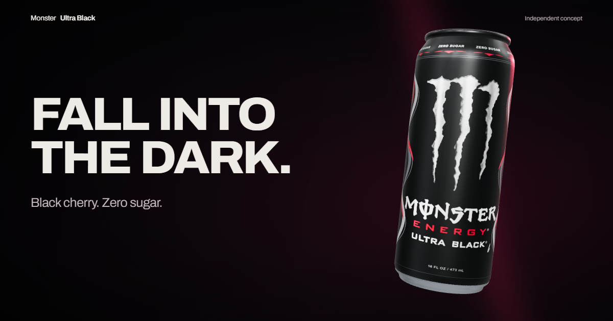

# Monster Ultra Black

A single-page portfolio concept built around a scroll-driven 3D can, cherry lighting and a rectangular label spotlight.



## Development

Requires Node.js 24 or later.

```sh
npm ci
npm run dev
```

Vite serves the site at `http://127.0.0.1:5173`. To test on a phone on the same local network, run `npm run dev -- --host 0.0.0.0` and use the computer's LAN address.

## Project layout

| Path                                | Purpose                                                       |
| ----------------------------------- | ------------------------------------------------------------- |
| `src/main.ts`                       | Starts the page, loads the scene and handles fallback/cleanup |
| `src/content/`                      | Section copy and the concept label transcription              |
| `src/ui/render-page.ts`             | HTML markup                                                   |
| `src/motion/poses.ts`               | Camera, can and lighting values for each section              |
| `src/motion/create-scroll-story.ts` | Scroll timing, text transitions and responsive composition    |
| `src/motion/smooth-progress.ts`     | Frame-rate-independent scroll smoothing                       |
| `src/scene/`                        | Three.js setup, model loading and the label shader            |
| `src/styles/page.css`               | Layout, typography and responsive styles                      |
| `public/`                           | Runtime models, images, favicon and font license              |
| `tests/`                            | Motion unit tests and browser regression tests                |

Start with [the architecture notes](docs/ARCHITECTURE.md) when changing the animation. Section order in `content/story.ts` and pose order in `motion/poses.ts` must match.

## Checks

```sh
npm run check
npx playwright install chromium
npm run test:browser
```

`check` runs formatting, TypeScript, motion tests and a production build. Browser tests use that build and start a local preview server when needed. They cover startup stability, resize, reverse scrolling, responsive reading, keyboard access, reduced motion and WebGL fallback.

Run `npm run format` to apply the shared formatting rules.

## Build and deployment

```sh
npm run build
npm run preview
```

Deploy only `dist/`. Netlify settings are in `netlify.toml`; Netlify's `URL` environment variable supplies canonical and social-image URLs automatically. For other hosts, set `SITE_URL` to the final HTTPS origin before building. See [deployment notes](docs/RELEASE.md).

The site has no backend, analytics, audio, shop or external runtime CDN. It loads the mobile GLB by default. The desktop GLB is an optional higher-resolution asset and is not downloaded by the app.

## Content and assets

Nutrition and ingredient text is a transcription of the supplied concept artwork, not a verified regional product specification. The site labels it accordingly.

Archivo is bundled locally under the [SIL Open Font License](public/fonts/OFL-Archivo.txt). Monster branding and product artwork are not offered as reusable brand assets. This repository does not grant rights to third-party trademarks or artwork.

Concept Project for Portfolio purposes only, not affiliated with Monster Energy Company. All trademarks belong to their respective owners.
